<div align="center">

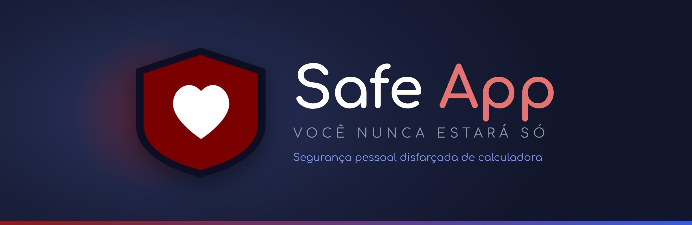

<br>


**[Por que existe](#-por-que-o-safeapp-existe) · [O sistema](#-conheça-o-sistema) · [Como entrar](#-como-entrar-no-app) · [Como foi feito](#-como-foi-feito) · [Identidade visual](#-identidade-visual) · [Como rodar](#-como-rodar-o-app)**

</div>

---

## 💜 Por que o SafeApp existe

Quando uma mulher está em risco, pedir ajuda precisa ser **rápido** e **discreto**. Pegar o celular e abrir um aplicativo de emergência pode chamar a atenção de quem está por perto, e em muitos casos essa pessoa é justamente quem representa o perigo.

O SafeApp nasceu para resolver isso de um jeito simples:

> Por fora, é uma **calculadora comum**. Por dentro, é a sua **rede de proteção**.

<table>
<tr>
<td width="33%" valign="top">

### 🎭 Discreto
Ninguém desconfia de uma calculadora. O app só abre com o seu código secreto.

</td>
<td width="33%" valign="top">

### ⚡ Rápido
Um toque no botão avisa seus contatos de confiança com a sua localização exata.

</td>
<td width="33%" valign="top">

### 📡 Funciona sem internet
Sem sinal, o aviso segue por SMS. Nada fica parado esperando conexão.

</td>
</tr>
</table>

---

## 📱 Conheça o sistema

<div align="center">
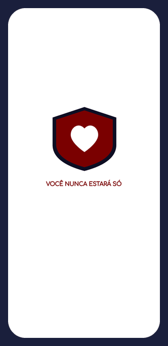
<br>
<sub>Da calculadora ao pedido de ajuda, em poucos toques.</sub>
</div>

<br>

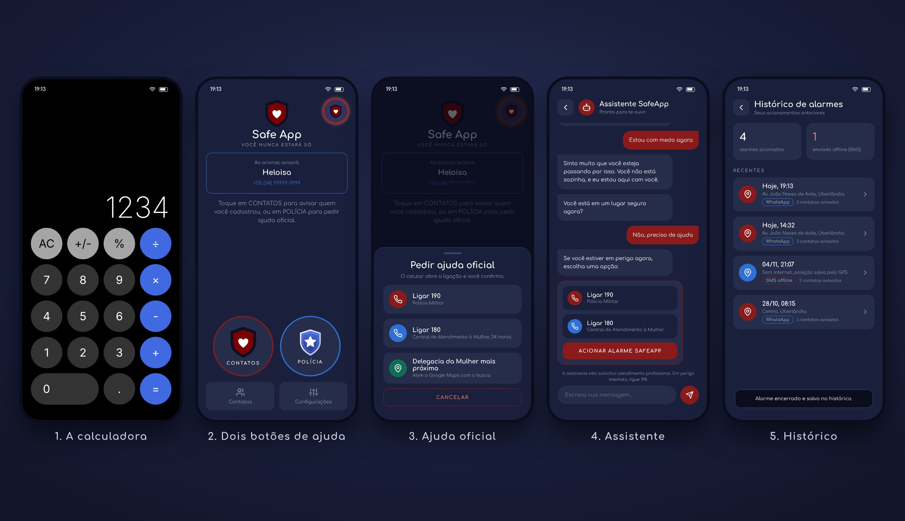

### O que o app faz

| | Função | Como funciona |
|---|---|---|
| 🧮 | **Calculadora camuflada** | É uma calculadora de verdade. Digitar o código secreto (padrão `1234`, pode ser trocado) e tocar em `=` abre o app. |
| ❤️ | **Botão CONTATOS** | Avisa as pessoas que você cadastrou, na ordem de prioridade (nível 1, 2 e 3), com sua localização no Google Maps. |
| 🛡️ | **Botão POLÍCIA** | Abre um menu para ligar para o **190** (Polícia Militar), para o **180** (Central de Atendimento à Mulher) ou buscar a **Delegacia da Mulher** mais próxima no Google Maps. |
| 📡 | **Funciona offline** | Com internet, o aviso sai pelo WhatsApp. Sem internet, sai por SMS e a localização é salva para sincronizar quando o sinal voltar. |
| 👥 | **Rede de proteção** | Cadastro de contatos de confiança, com três níveis de prioridade. |
| 🕘 | **Histórico de alarmes** | Guarda os últimos 50 alarmes (data, canal, contatos e localização). Fica em **Configurações > Histórico de alarmes**. |
| 💬 | **Assistente de ajuda** | O botão redondo com o escudo, no topo da tela principal. Acolhe, orienta, explica direitos (Lei Maria da Penha) e mostra os telefones de emergência. Funciona sem internet. |
| 🔐 | **Biometria** | Opcional. Depois do código secreto, pede a digital ou o Face ID. |
| 🗺️ | **Rastreamento no navegador** | Uma página web mostra a localização de quem acionou o alarme, ao vivo. |

### Galeria de telas

<details>
<summary><b>Clique para ver todas as telas</b></summary>

<br>

<table>
<tr>
<td align="center" width="25%"><br><sub><b>Abertura</b></sub></td>
<td align="center" width="25%">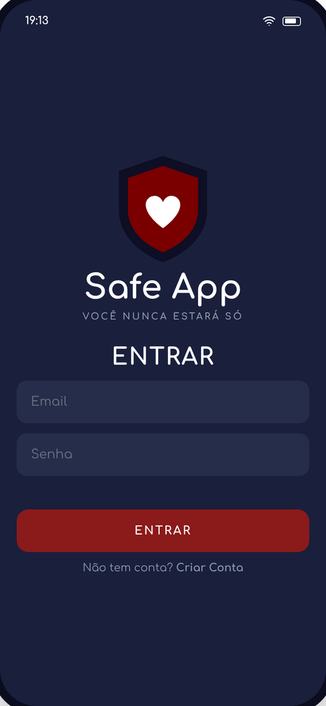<br><sub><b>Login</b></sub></td>
<td align="center" width="25%">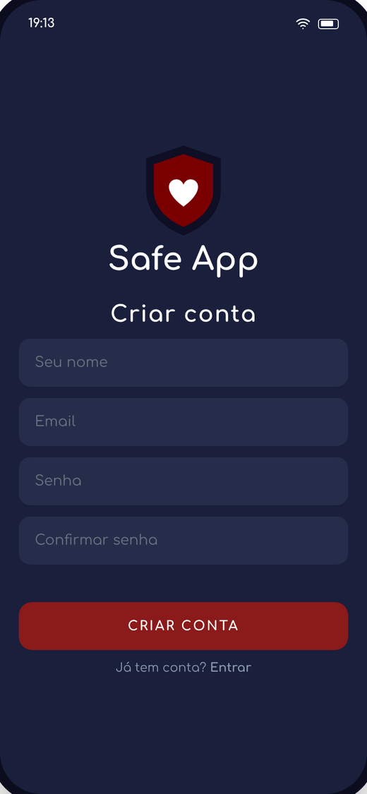<br><sub><b>Criar conta</b></sub></td>
<td align="center" width="25%">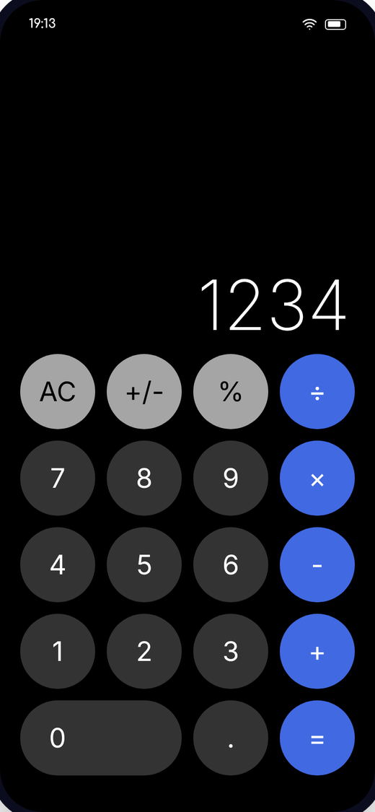<br><sub><b>Calculadora (o disfarce)</b></sub></td>
</tr>
<tr>
<td align="center">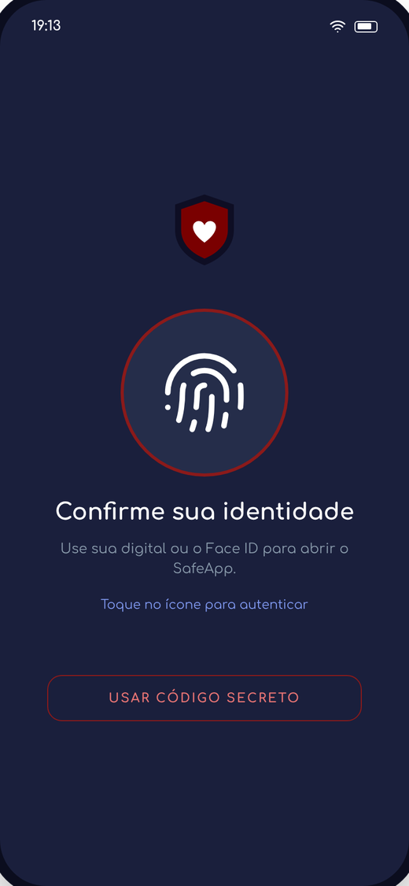<br><sub><b>Biometria</b></sub></td>
<td align="center">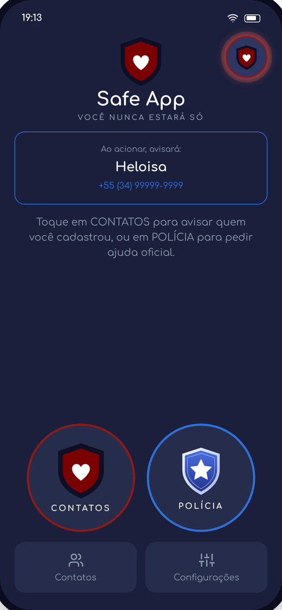<br><sub><b>Tela principal</b></sub></td>
<td align="center">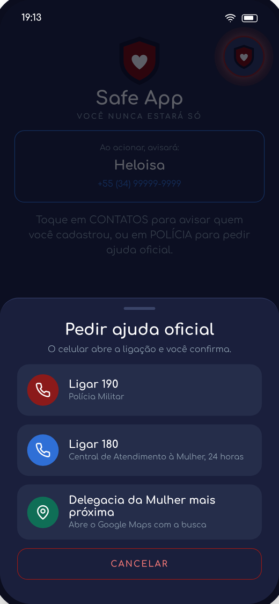<br><sub><b>Ajuda oficial</b></sub></td>
<td align="center">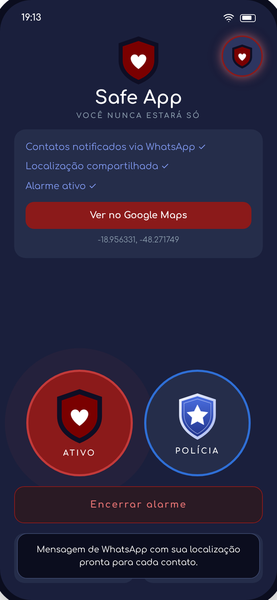<br><sub><b>Alarme ativo</b></sub></td>
</tr>
<tr>
<td align="center">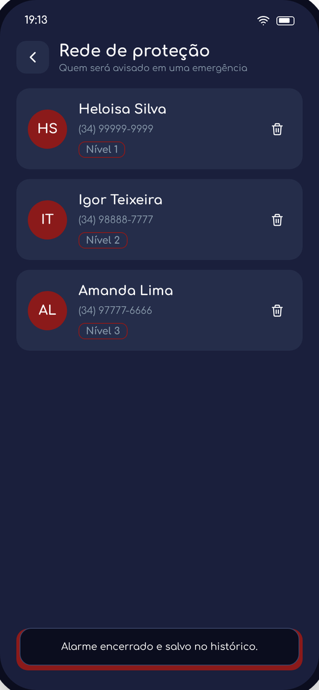<br><sub><b>Rede de proteção</b></sub></td>
<td align="center">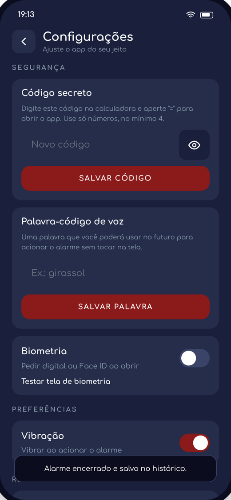<br><sub><b>Configurações</b></sub></td>
<td align="center">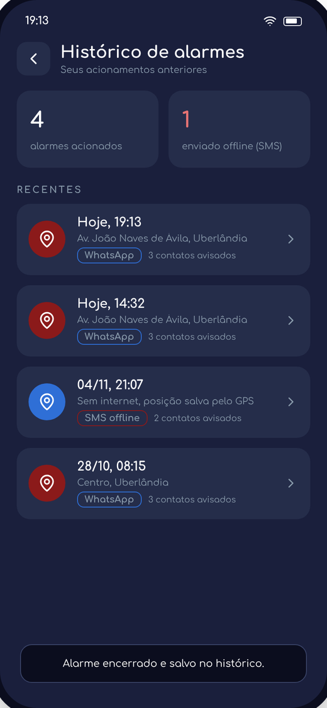<br><sub><b>Histórico de alarmes</b></sub></td>
<td align="center">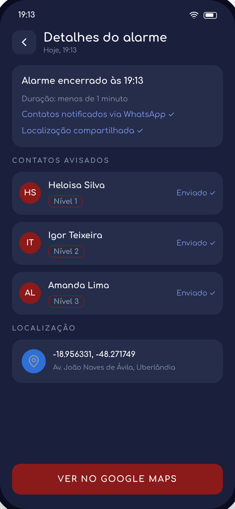<br><sub><b>Detalhe do alarme</b></sub></td>
</tr>
<tr>
<td align="center">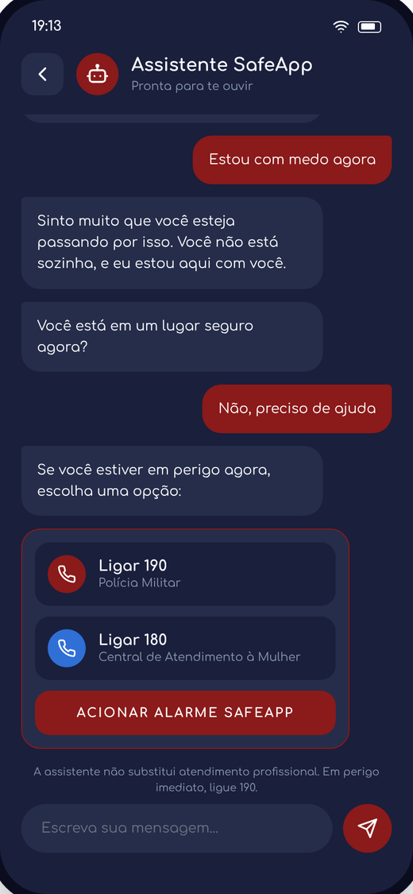<br><sub><b>Assistente de ajuda</b></sub></td>
<td></td><td></td><td></td>
</tr>
</table>

<sub>As telas acima vêm do protótipo clicável do projeto, que reproduz o layout do aplicativo.</sub>

</details>

---

## 🚪 Como entrar no app

O segredo do SafeApp é a entrada. Quem olha vê só uma calculadora.

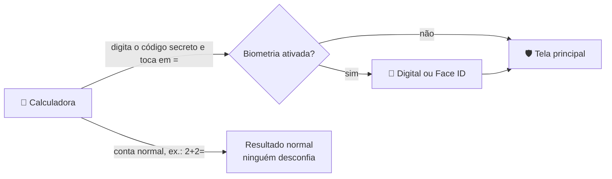

1. Abra o app. Aparece uma **calculadora comum**.
2. Digite o seu **código secreto** (o padrão é `1234`) e toque em `=`.
3. Se você ativou a biometria, confirme com a **digital** ou o **Face ID**.
4. Pronto: a tela principal abre, com os botões **CONTATOS** e **POLÍCIA**.

> 💡 Você pode trocar o código secreto a qualquer momento em **Configurações**.

---

## 🛠️ Como foi feito

### Tecnologias

| Camada | O que usamos | Para quê |
|---|---|---|
| Aplicativo | **React Native** com **Expo** (SDK 58) | Um só código para Android e iPhone |
| Navegação | **React Navigation** | Troca entre as telas |
| Banco e login | **Firebase** (Authentication e Realtime Database) | Contas, e localização do alarme ao vivo |
| Localização | `expo-location` | Pegar o GPS no momento do alarme |
| Conexão | `@react-native-community/netinfo` | Descobrir se há internet e escolher WhatsApp ou SMS |
| Dados locais | `@react-native-async-storage/async-storage` | Contatos, código secreto e histórico, salvos só no aparelho |
| Biometria | `expo-local-authentication` | Digital e Face ID |
| Rastreamento | **Firebase Hosting** (página web) | Mostrar a localização de quem acionou o alarme |

### O que acontece quando o alarme é acionado

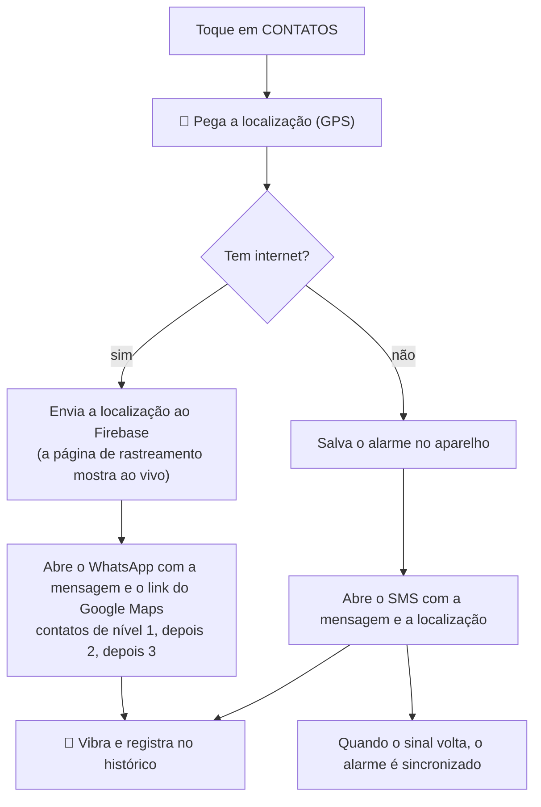

### Decisões de projeto

- **Disfarce de verdade.** A calculadora faz contas reais. Não é uma tela falsa.
- **Privacidade primeiro.** Contatos, código secreto e histórico ficam **só no aparelho**.
- **Funciona sem internet.** Sem sinal, o app muda sozinho para SMS e guarda o alarme para sincronizar depois.
- **O celular confirma o envio.** Celulares não deixam um app enviar WhatsApp ou SMS, nem ligar, sem a pessoa confirmar. O SafeApp deixa tudo pronto (mensagem escrita, número discado) e a pessoa só toca para enviar.
- **Assistente simples e confiável.** Responde por palavras-chave, sem inteligência artificial, para funcionar offline e nunca inventar uma orientação.
- **Ajuda oficial a um toque.** O botão POLÍCIA reúne o 190, o 180 e a busca pela Delegacia da Mulher, porque não existe um número único nacional para as delegacias.

### Estrutura do projeto

<details>
<summary><b>Clique para ver as pastas e arquivos</b></summary>

```
SafeApp/
├── App.js                      Navegação entre as telas
├── app.json                    Configuração do Expo
├── assets/                     Logo, ícones, distintivo
├── docs/img/                   Imagens deste README
├── src/
│   ├── firebase.js             Configuração do Firebase
│   ├── historico.js            Salva e lê o histórico de alarmes
│   ├── biometria.js            Digital / Face ID
│   ├── components/
│   │   └── BotaoAssistente.js  Botão redondo do assistente
│   └── screens/
│       ├── LoginScreen.js
│       ├── CadastroScreen.js
│       ├── CalculadoraScreen.js
│       ├── BiometriaScreen.js
│       ├── PanicoScreen.js     Tela principal (CONTATOS e POLÍCIA)
│       ├── ContatosScreen.js
│       ├── ConfiguracoesScreen.js
│       ├── HistoricoScreen.js
│       ├── AlarmeDetalheScreen.js
│       └── RoboScreen.js       Assistente de ajuda
└── web/                        Firebase (Hosting e Functions)
    ├── public/index.html       Página de rastreamento
    └── functions/              Envio de SMS pela nuvem (opcional)
```

</details>

---

## 🎨 Identidade visual

A identidade do SafeApp passa **acolhimento** e **segurança**: um escudo vinho com um coração, sobre um fundo azul-noite calmo, e uma fonte arredondada e gentil.

### Logo

<div align="center">

<br>
<sub>Um escudo (proteção) com um coração (cuidado).</sub>
</div>

### Paleta de cores

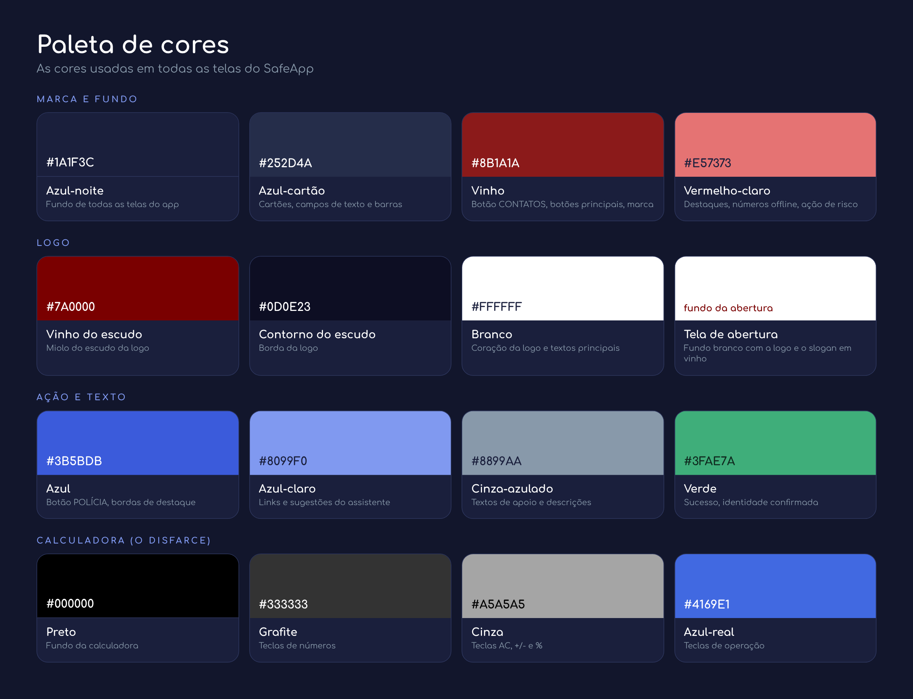

<details>
<summary><b>Resumo dos códigos de cor</b></summary>

<br>

| Cor | Código | Onde aparece |
|---|---|---|
| Azul-noite | `#1A1F3C` | Fundo das telas |
| Azul-cartão | `#252D4A` | Cartões, campos de texto e barras |
| Vinho | `#8B1A1A` | Botão CONTATOS, botões principais |
| Vermelho-claro | `#E57373` | Destaques e ações de risco |
| Azul | `#3B5BDB` | Botão POLÍCIA e bordas de destaque |
| Azul-claro | `#8099F0` | Links e sugestões do assistente |
| Cinza-azulado | `#8899AA` | Textos de apoio |
| Branco | `#FFFFFF` | Textos principais e coração da logo |
| Verde | `#3FAE7A` | Sucesso e identidade confirmada |
| Vinho do escudo | `#7A0000` | Miolo da logo |
| Contorno do escudo | `#0D0E23` | Borda da logo |
| Preto, grafite, cinza e azul-real | `#000000` `#333333` `#A5A5A5` `#4169E1` | A calculadora (o disfarce) |

</details>

### Fonte

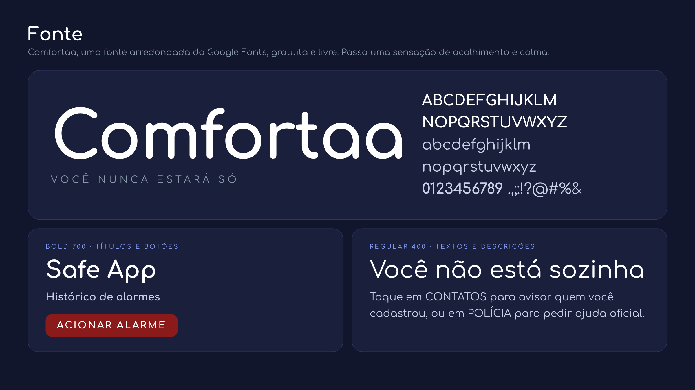

A fonte é a **[Comfortaa](https://fonts.google.com/specimen/Comfortaa)**, do Google Fonts (gratuita e de código aberto), em dois pesos:

- **Bold 700**: títulos e botões
- **Regular 400**: textos e descrições

---

## 🚀 Como rodar o app

### O que você precisa

- [Node.js](https://nodejs.org/) (versão LTS)
- [Git](https://git-scm.com/)
- O aplicativo **Expo Go** no celular (Android ou iPhone)
- Celular e computador na **mesma rede Wi-Fi**

### Passo a passo

```bash
# 1. Baixar o projeto
git clone https://github.com/heloisasl/SafeApp.git
cd SafeApp

# 2. Instalar as dependências
npm install

# 3. Iniciar
npx expo start --clear
```

Vai aparecer um **QR Code** no terminal. Abra o Expo Go e leia o código (no iPhone, use a câmera do aparelho).

### Usando o app

1. Crie uma conta (ou entre com a sua).
2. Na calculadora, digite o código secreto (`1234` por padrão) e toque em `=`.
3. Em **Contatos**, cadastre quem deve ser avisado.
4. Na tela principal, toque em **CONTATOS** para disparar o alarme, ou em **POLÍCIA** para ver as opções de ajuda oficial.
5. Em **Configurações**, troque o código secreto, ative a biometria e veja o **Histórico de alarmes**.

<details>
<summary><b>Configurando o seu próprio Firebase</b></summary>

<br>

O arquivo `src/firebase.js` aponta para o projeto Firebase da equipe. Para usar o seu:

1. Crie um projeto em [console.firebase.google.com](https://console.firebase.google.com/).
2. Ative **Authentication** (e-mail e senha) e **Realtime Database**.
3. Em *Configurações do projeto*, registre um app Web e copie o `firebaseConfig` para `src/firebase.js`.
4. Em **Realtime Database > Regras**, restrinja o acesso. Não deixe o banco aberto para qualquer pessoa.

</details>

<details>
<summary><b>Envio de SMS pela nuvem (opcional)</b></summary>

<br>

> **O app funciona sem esta etapa.** O aviso por WhatsApp e por SMS já sai do próprio celular. A Cloud Function é um recurso extra e o Firebase só permite publicá-la no plano **Blaze** (pago, com cartão de crédito). Na versão atual do projeto ela **não está publicada**.

A pasta `web/functions` tem a função `enviarSMS`, que dispara quando um novo alarme é criado e manda um SMS com o link de rastreamento para cada contato. As credenciais do Twilio **não ficam no código**:

```bash
cd web/functions
cp .env.example .env      # no Windows: copy .env.example .env
```

Preencha `TWILIO_SID`, `TWILIO_TOKEN` e `TWILIO_NUMBER` no `.env` e publique com `firebase deploy --only functions`. O arquivo `.env` está no `.gitignore` e nunca deve ir para o GitHub.

</details>

---

## ⚠️ Limites importantes

- Celulares **não permitem** que um app envie WhatsApp ou SMS, nem faça ligações, sem a pessoa confirmar. O SafeApp deixa tudo pronto e a pessoa confirma com um toque.
- A biometria por **Face ID não funciona dentro do Expo Go no iPhone** (cai para a senha do aparelho). Funciona em app compilado e, no Android, também no Expo Go.
- O assistente **não é uma inteligência artificial**: responde por palavras-chave.

## 🔭 Trabalhos futuros

- Conectar uma inteligência artificial ao assistente de ajuda
- Acionamento por voz com a palavra-código
- Gravação de áudio durante o alarme
- Envio de SMS pela nuvem (plano Blaze do Firebase)
- Publicação nas lojas de aplicativos

---

## 👩‍💻 Equipe

Trabalho de Conclusão de Curso de **Ciência da Computação**, **UNITRI** (Uberlândia, MG), 2026.

- Heloisa
- Isaac Silva
- Igor Filipi Teixeira
- Amanda Lima

## 🆘 Em caso de perigo

O SafeApp é um projeto acadêmico e **não substitui os serviços oficiais de emergência**.

📞 **190** Polícia Militar · 📞 **180** Central de Atendimento à Mulher (24 horas) · 📞 **192** SAMU

<div align="center">

<br>


**Você nunca estará só.**

</div>
